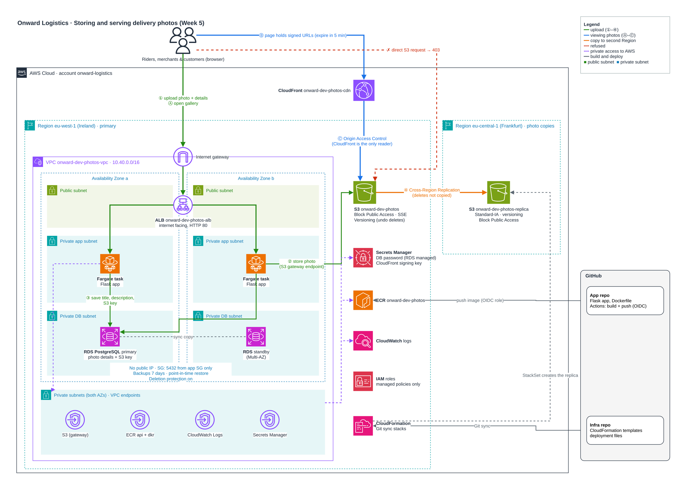

# Storing and Serving Delivery Photos for Onward Logistics (infrastructure)

Week 5 lab, Databases & Storage on AWS. Riders upload delivery photos with their details;
customers and merchants view them in a gallery. This repository holds the CloudFormation;
the application is in [week5-aws-lab-delivery-photos-app](https://github.com/ghaby27/week5-aws-lab-delivery-photos-app).



| | |
|---|---|
| Discovery report | [docs/discovery-report.docx](docs/discovery-report.docx) |
| Architecture | [architecture.drawio](architecture.drawio) |
| Cost | about USD 155 a month ([AWS Pricing Calculator estimate](https://calculator.aws/#/estimate?id=91cc63ccdfbf8f3b6e6d59ac6a4070953f5b0fee)) |

## Stacks

Deployed by CloudFormation Git sync from `infra/<layer>/deployment.yaml`, in this order:

| Stack | Template | What it holds |
|---|---|---|
| `onward-dev-photos-artifacts` | `infra/artifacts/template.yaml` | ECR repository, nested-template bucket, GitHub OIDC roles, StackSet roles |
| `onward-dev-photos-platform` | `infra/platform/main.yml` | Root stack nesting the five stacks below |

Nested stacks in `infra/platform/stacks/`:

| Stack | What it holds |
|---|---|
| `network.yaml` | VPC in two AZs: public subnets (ALB), private app subnets (tasks), private DB subnets; VPC endpoints instead of NAT |
| `security.yaml` | Security groups (ALB from internet, tasks from ALB, DB from tasks) and the ECS roles |
| `storage.yaml` | Private, versioned photos bucket replicated to `eu-central-1` (StackSet), CloudFront with Origin Access Control and signed URLs, the signing key |
| `database.yaml` | RDS for PostgreSQL, Multi-AZ, private, password managed by RDS in Secrets Manager |
| `service.yaml` | Internet-facing ALB and the ECS Fargate service (2 tasks, one per AZ) |

A change under `infra/platform/stacks/` is published by `.github/workflows/publish-templates.yml`:
it uploads the templates to S3 and commits the new `TemplatesVersion`, which Git sync then deploys.
No inline IAM policies anywhere; every permission is an AWS or customer managed policy.

## Build and tear down

With [onward-bootstrap](https://github.com/ghaby27/onward-bootstrap) cloned next to this repository:

```sh
../onward-bootstrap/deploy.sh .     # about 30 minutes (Multi-AZ RDS and CloudFront take the longest)
../onward-bootstrap/teardown.sh .   # empties the buckets and lifts DB deletion protection first
```

`scripts/hooks/` holds the steps the bootstrap runs before the platform (upload the nested
templates, build the first image) and before teardown.

## Checks for the live review

| Check | How |
|---|---|
| Upload appears with its details | Upload a photo on `/upload`; it shows in the gallery with title, description, merchant, order, rider, city |
| Photo not in the database, DB not reachable | The `photos` table has only details and `s3_key`; the DB has no public endpoint and its subnets no internet route |
| Direct S3 request refused | `curl -I https://onward-dev-photos-<account>.s3.eu-west-1.amazonaws.com/<key>` returns 403; an expired signed URL returns 403 from CloudFront |
| No credentials in the repositories | DB password and signing key are only in Secrets Manager; GitHub uses OIDC |
| Deleted photo or record recovered | Delete in the gallery, then Restore on `/deleted` (S3 version copied back); a record deleted outside the app comes back with RDS point-in-time restore |
| Photo in a second Region | `aws s3 ls s3://onward-dev-photos-replica-<account>/photos/ --recursive --region eu-central-1` |
| Container or AZ lost | Stop a task: the other one serves and ECS replaces it. Reboot RDS with failover to move it to the other AZ |
| Rebuild from the repositories | `teardown.sh` then `deploy.sh` |
